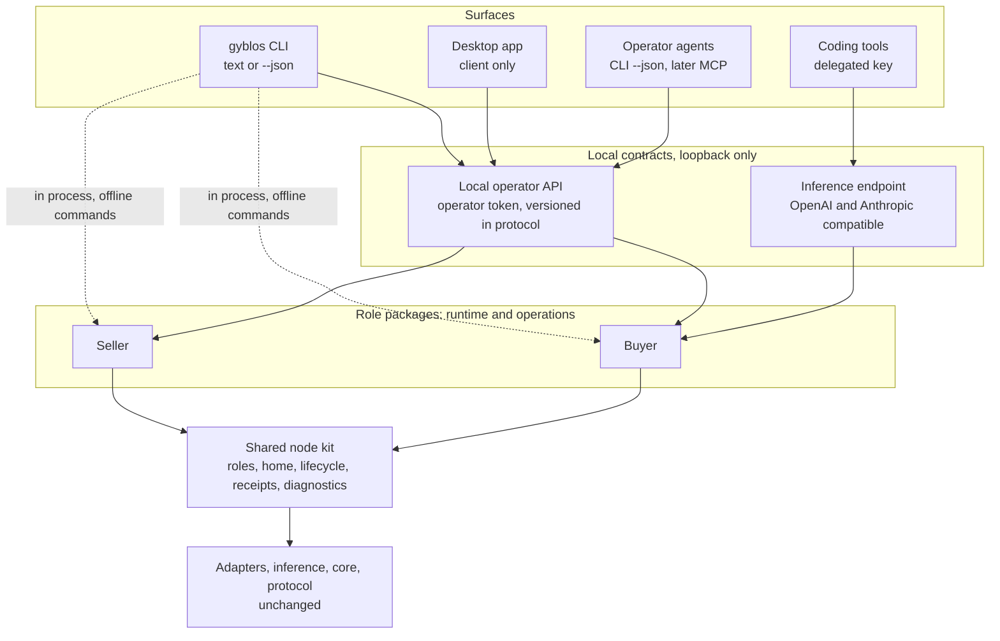
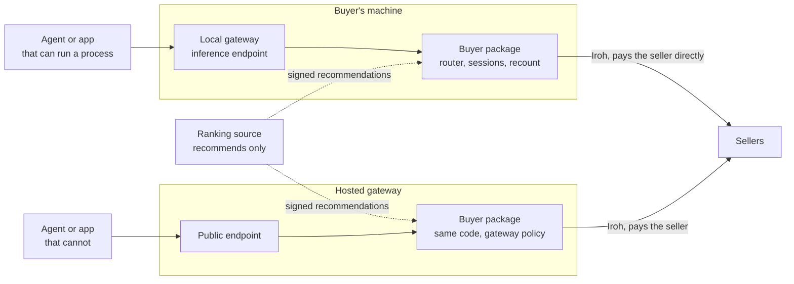

# Target architecture

**Status: Decided**, with the [open decisions](#open-decisions) still to be
made. This page specifies where the repository is going, not what it does today.
[architecture.md](architecture.md) describes the current code. Nothing here is
implemented until the code and that page say so.

The goal is one product that serves people and software agents equally: a person
in the desktop app, an operator in a terminal and an agent with no window all
use the same operations, on either role.

## Goals

- **Symmetric roles.** The seller and the buyer are each a library with a thin
  executable around it. Both reach protocol, core and the adapters the same way.
- **One operation, many surfaces.** Every command is a function with validated
  input and a typed result. The CLI, the local API and any agent tool only call
  it and present the result.
- **Agents are first-class.** Everything a person can do through a window, an
  agent can do without one, with machine-readable output.
- **One contract for local control.** The desktop app and a headless agent use
  the same authenticated local API. The app holds no logic of its own that an
  agent would have to reimplement.
- **Durable state has one owner.** Financial state lives in the role's process
  and its home, never in a second copy inside a user interface.

## Non-goals

- No change to protocol, core, inference or the adapters. Their boundaries stay
  as [architecture.md](architecture.md) describes them.
- No new payment path. Paid inference uses USDC payment channels on Solana
  through the x402 `batch-settlement` scheme
  ([payment-sessions.md](payment-sessions.md)).
- No wire change. Signed contracts, signing domains, golden vectors, journals
  and private paths are preserved by every structural step.
- No hosted gateway design. [Routing and gateways](#routing-and-gateways) fixes
  where a hosted gateway attaches and what it must reuse; its accounts, custody,
  pricing and data policy are not specified here.

## Today and target

| Concern                 | Today                                                                                                                                         | Target                                                                       |
| ----------------------- | --------------------------------------------------------------------------------------------------------------------------------------------- | ---------------------------------------------------------------------------- |
| Seller logic            | In `packages/node`; `apps/node` is a thin CLI and daemon                                                                                      | In a seller package; unchanged shape                                         |
| Buyer logic             | Mostly in `apps/buyer`: selection, discovery, routing, the HTTP endpoint and buyer API keys                                                   | In a buyer package; `apps/buyer` is a thin executable                        |
| Buyer commands          | Eight `pnpm buyer*` scripts, from a checkout only; `pnpm buyer` is the one automatic buyer                                                    | `gyblos buyer <command>` in the released executable                          |
| `packages/node`         | Both roles, PayPal, `config.toml`, receipts and agent setup in one package                                                                    | A shared node kit with nothing specific to one role                          |
| Desktop app             | Bundles `apps/buyer` as a utility process and keeps its own Chat budget and permission state                                                  | A client of the buyer's local API; holds no financial state                  |
| Local control           | Local buyer routes named in `@gyblos/protocol` (`buyer-api`), served only to the desktop app; the operator token lives in the desktop process | One versioned local operator API per role, usable without the desktop app    |
| Machine-readable output | `gyblos logs --json` only                                                                                                                     | `--json` on every command, with codes from the owning catalog                |
| Agent access            | Inference through delegated keys; setup for four coding tools                                                                                 | The same, plus every operator task through the CLI or the local operator API |

## Target shape

Dependency direction stays downward: surfaces → role packages → shared node kit
→ adapters and inference → core → protocol.

## Components

### Role packages

A role package owns everything that role does and exposes it two ways: a runtime
with a lifecycle, and a set of operations.

| Package | Owns                                                                                                                                    |
| ------- | --------------------------------------------------------------------------------------------------------------------------------------- |
| Seller  | Offers, control, free and paid channels, payment sessions, publication, registration, seller status and the seller's `config.toml`      |
| Buyer   | Discovery state, seller selection inputs, the offer race, routing, payment sessions, recounting, buyer API keys, the inference endpoint |

Rules:

- A role package imports the shared node kit, adapters, inference, core and
  protocol. It never imports the other role package or an app.
- Importing it starts nothing. Engines, sockets, timers and wallets start in
  lifecycle functions.
- It never reads `process.argv`, writes to standard output or exits the process.
  Those belong to the executable.

The package names are provisional and are settled when the split is made.

### Shared node kit

What both roles need and neither owns: role keys and role files, the local home
layout, the node lifecycle, receipt orchestration and storage, the receipt
uploader, diagnostics and telemetry startup. It contains no seller-only or
buyer-only policy.

### Operations

An operation is the unit every surface shares.

- **Input** arrives as `unknown` and is validated at the boundary.
- **Result** is a discriminated value: success with typed data, or failure with
  a code from the owning package's catalog. No operation throws for an expected
  failure.
- **No presentation.** An operation returns data. It prints nothing and formats
  nothing for a terminal.
- **No secrets in results.** A result never carries a private key, the operator
  token, a signed payment payload or a value read from the environment. A
  delegated key appears once, in the result of the operation that creates it.
- **Stable JSON.** The serialized result is a contract: field names and codes
  change only with a version change.
- **Safety is unchanged.** An operation never retries a payment, clears a
  journal or releases a lock to succeed. Uncertain payments still block further
  calls until reconciled ([recovery.md](recovery.md)).

Initial operation set, from the commands that exist today:

| Role   | Operations                                                                                                            |
| ------ | --------------------------------------------------------------------------------------------------------------------- |
| Seller | `init`, `start`, `status`, `doctor`, `register`, `service install`, `service uninstall`, `config validate`            |
| Buyer  | `init`, `start`, `status`, `keys create`, `keys list`, `keys revoke`, `agent setup`, `reconcile`, `withdraw`, `trust` |

### Command line

- One executable, `gyblos`, carries both roles: `gyblos seller <command>` and
  `gyblos buyer <command>`. The existing top-level seller commands keep working;
  renaming them is a separate decision.
- Every command accepts `--json` and then prints exactly one JSON document, the
  operation result, on standard output. Without it, the command prints text for
  a person.
- The exit code is `0` on success and nonzero on failure, in both modes.
- Every command can run without a terminal: each prompt has a flag or an
  environment variable, and a missing required value is a failure with a code,
  never a hang.
- Commands that need no running daemon (`init`, `doctor`, `config validate`)
  call the operation in process. Commands that act on a running role call its
  local operator API.

### Local operator API

The control contract of a running role. It replaces the desktop-only wiring.

- Listens on loopback only, checks the `Host` header and rejects any request
  that carries an `Origin`.
- Authenticated by the operator token. A delegated key never grants an operator
  action.
- Its routes, request and response shapes, and error codes are defined in
  `packages/protocol` and covered by golden vectors, like every other contract.
- It is separate from the inference endpoint, which keeps serving OpenAI Chat
  Completions, OpenAI Responses and Anthropic Messages to delegated keys
  ([buyer-api-keys.md](buyer-api-keys.md)).
- It exposes the role's operations and nothing else. It carries no prompt, no
  response and no signed payment payload.

### Desktop app

- A client of the buyer's local operator API and inference endpoint. It starts
  the same buyer the CLI starts and stops it on quit.
- It keeps what belongs to a window: conversations, drafts, appearance and the
  protected wallet's custody. Budgets, reservations, journals and keys are read
  from the buyer, not mirrored.
- The renderer keeps no network access and never sees a credential.
- Driving a seller from the app is possible through the same contract and is not
  part of this specification.

### Agents

- **Buying inference** already works: a delegated key with a spending limit on
  the inference endpoint.
- **Operating a role** uses the CLI with `--json` first. A Model Context
  Protocol server over the same operations is a later surface and adds no logic.
- An agent never receives the operator token through a tool result, a log or a
  generated configuration file.

## Routing and gateways

Three different things are often called a router or a gateway. They sit at
different places and only one of them is new.

| Name           | What it is                                                                                              | Where it runs                       | Status                    |
| -------------- | ------------------------------------------------------------------------------------------------------- | ----------------------------------- | ------------------------- |
| Router         | The selection logic: hard filters, weighted sampling and the offer race. A pure function, today in core | Inside every buyer, local or hosted | Exists (`selectSellers`)  |
| Local gateway  | The buyer's inference endpoint on loopback: OpenAI and Anthropic compatible, paid by a delegated key    | The buyer's own machine             | Exists                    |
| Hosted gateway | The buyer package run as a service with a public endpoint, for clients that cannot run a local process  | Gyblos or any third party           | Future; not designed here |
| Ranking source | A service that returns signed seller recommendations from network-wide data. It never sees a prompt     | Gyblos or any third party           | Future; not designed here |

Rules that hold for all of them:

- **One router.** A hosted gateway runs the same selection function with its own
  policy. No gateway reimplements filters, the offer race or recounting.
- **A gateway is a host, not a stack.** It composes the buyer package, exactly
  as the CLI and the desktop app do. This is why buyer logic must leave
  `apps/buyer` before a hosted gateway exists.
- **A ranking source only recommends.** The buyer applies every hard filter
  itself, verifies each seller independently and pays the seller directly. A
  recommendation never widens a permission, replaces a selection silently or
  authorizes spending.
- **The local path needs no third party.** A buyer keeps working with local
  selection alone when no ranking source or hosted gateway is reachable.
- **Privacy differs and is stated.** On the local path only the chosen seller
  sees a prompt. A hosted gateway also sees it. That difference is disclosed to
  the client, never implied away.

What a hosted gateway adds that no local buyer has, and that needs its own
design before any implementation: a public listener (everything else here is
loopback only), accounts and per-client spending, who holds the funds that pay
sellers, abuse limits, and a data policy.

### Router contract

The router moves to a package of its own, `packages/router`, extracted from the
selection functions in `packages/core`. Third-party routers are not built yet.
The contract below is fixed now so that adding one later is a new adapter and
not a redesign.

Selection has two stages, and only the second is replaceable:

| Stage     | Does                                                                                                                              | Owner                    |
| --------- | --------------------------------------------------------------------------------------------------------------------------------- | ------------------------ |
| Admission | Hard filters: live records, model and reasoning level, price ceilings, badge, retention, cooldown, pin. Produces the eligible set | The buyer, always        |
| Ranking   | Orders the eligible set and may explain why                                                                                       | A router, chosen by name |

After ranking, the buyer continues as today: the offer race, quote verification,
payment and recount are not part of the router.

The `Router` port is declared in `packages/protocol`, next to the other plugin
ports. A router receives:

- the request shape: model, reasoning level, token limits and price ceilings;
- the eligible candidates: owner, NodeId and signed listing;
- a seed for any randomness, so a choice can be replayed.

It returns an ordered list of NodeIds, a reason code per candidate and its own
name and version. It never receives prompt content, keys, wallet state or the
buyer's private history.

Rules the buyer enforces on every router, local or not:

- A returned NodeId outside the eligible set is discarded. A router cannot add a
  seller, widen a ceiling, override a pin or authorize spending.
- A router has a deadline. On a timeout, an error or an empty answer the buyer
  falls back to the built-in router. A router failure never fails a request.
- A router is never asked again for a paid request that may already have been
  sent.
- Each choice records which router and version made it, without content, so
  routers can be compared on cost, failures and latency.
- The buyer picks its router by name in its own configuration. The built-in
  router is the default and needs no third party.

Packages:

| Package           | Holds                                                                                                                   | When          |
| ----------------- | ----------------------------------------------------------------------------------------------------------------------- | ------------- |
| `packages/router` | Admission, the built-in ranking, its parameters in one versioned public file, and a simulator that replays network data | Step 9        |
| `router-*`        | An adapter per external router, implementing the same port. It joins the adapter families in the boundary rules         | Router market |

A third-party router is a remote service behind a `router-*` adapter. Its code
never runs in the process that holds the buyer's keys.

Left to the router market design, and not needed to keep the plug-in point open:
how ranking providers are discovered and identified, the signed wire format of a
recommendation and its golden vectors, the price and unit of a recommendation
and how it is paid, and how routers are evaluated publicly.

## Invariants

Each of these is checkable, by `pnpm boundaries`, a lint rule or a test.

1. No app imports another app. No role package imports the other role.
2. No package below the apps reads `process.argv`, writes to standard output or
   calls `process.exit`.
3. Every command has a `--json` form whose output parses as one document and
   matches the operation's result contract.
4. Every failure code in a result comes from one owning catalog.
5. The local operator API accepts only loopback hosts and the operator token.
6. No result, log or diagnostic contains a key, a token or a payment payload.
7. The desktop app stores no budget, reservation or journal of its own.

## Sequence

Each step is its own change. Structural moves and behavior changes never share
one, and every structural step preserves wire values, journals and private
paths.

| Step | Change                                                                                                               | Kind       |
| ---- | -------------------------------------------------------------------------------------------------------------------- | ---------- |
| 1    | One buyer entry with subcommands; the existing scripts point to it                                                   | Behavior   |
| 2    | The released executable includes the buyer as `gyblos buyer`                                                         | Behavior   |
| 3    | `--json` and non-interactive operation on seller and buyer commands                                                  | Behavior   |
| 4    | Remove v1 signed offers, which no product path uses                                                                  | Removal    |
| 5    | Move buyer orchestration from `apps/buyer` into a buyer package                                                      | Structural |
| 6    | Split `packages/node` into the seller package, the buyer package and the shared node kit                             | Structural |
| 7    | Complete the local operator API in protocol and move the desktop app onto it                                         | Behavior   |
| 8    | Agent tool surface over the same operations                                                                          | Behavior   |
| 9    | Extract seller selection from core into `packages/router`, split into admission and ranking behind the `Router` port | Structural |

Steps 1 to 3 give an agent a buyer without a window and move no logic.

## Open decisions

These need a maintainer decision before the step that depends on them.

| Decision                                        | Needed before | Trade-off                                                                                                        |
| ----------------------------------------------- | ------------- | ---------------------------------------------------------------------------------------------------------------- |
| Where a headless buyer keeps the operator token | Step 3        | A private file in the buyer home is simple, but any process of that user could then create delegated keys.       |
| Renaming top-level seller commands              | Step 2        | `gyblos seller start` is symmetric; `gyblos start` is what installers and service units call today.              |
| When to split `packages/node`                   | Step 6        | It is the largest structural change and the least visible. Steps 1 to 3 and 7 deliver the agent goal without it. |
| Whether the desktop app can run a seller        | After step 7  | The contract allows it; it adds lifecycle, service and capacity concerns to an app that is buyer-only today.     |
